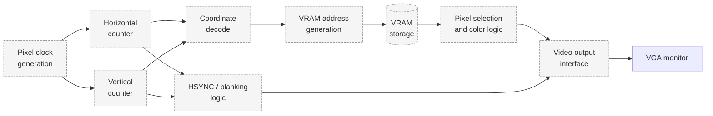

# Pixels

**A discrete graphics-processing system built from 7400-series TTL logic, custom VRAM addressing, and VGA timing, targeting stable output on a physical monitor.**

> **Status: Engineering plan and in-progress hardware development.** This README describes the intended architecture, the planned verification sequence, and the milestones the project is working toward. No subsystem is documented here as complete. Items marked `[TBD]` are placeholders for information that must come from the physical build and its measurements. Simulated behavior, bench-tested circuits, and integrated hardware output are reported separately (see [Testing and Physical Verification](#11-testing-and-physical-verification)).

---

## Table of Contents

1. [Overview](#1-overview)
2. [Motivation and Engineering Objectives](#2-motivation-and-engineering-objectives)
3. [Core Differentiator: Discrete TTL Graphics Hardware](#3-core-differentiator-discrete-ttl-graphics-hardware)
4. [Conceptual System Architecture](#4-conceptual-system-architecture)
5. [Graphics Pipeline](#5-graphics-pipeline)
6. [Custom VRAM Addressing and Memory Organization](#6-custom-vram-addressing-and-memory-organization)
7. [VGA Timing and Display Output](#7-vga-timing-and-display-output)
8. [Hardware Components and Bill of Materials](#8-hardware-components-and-bill-of-materials)
9. [Physical Implementation and Wiring](#9-physical-implementation-and-wiring)
10. [Digital Design Principles and Engineering Constraints](#10-digital-design-principles-and-engineering-constraints)
11. [Testing and Physical Verification](#11-testing-and-physical-verification)
12. [Build and Usage Instructions](#12-build-and-usage-instructions)
13. [Demonstrations, Schematics, and Measurements](#13-demonstrations-schematics-and-measurements)
14. [Current Capabilities and Limitations](#14-current-capabilities-and-limitations)
15. [Development Roadmap](#15-development-roadmap)
16. [References and Technical Resources](#16-references-and-technical-resources)
17. [Third-Party Acknowledgements](#17-third-party-acknowledgements)
18. [Contribution Guidelines](#18-contribution-guidelines)
19. [License](#19-license)

---

## 1. Overview

Pixels asks how graphics-processing functionality can be built from fundamental digital logic. Rather than using an integrated GPU, an FPGA development board, or a software renderer, the project constructs the pipeline from discrete 7400-series TTL integrated circuits on breadboards and custom wire-wrapped interconnects.

The defining milestone is a discrete-logic system that generates pixel data, stores and addresses it in a custom video memory, produces correctly timed horizontal and vertical synchronization, and drives a physical VGA-compatible monitor with a stable image. Each of these functions is a separate engineering problem, and the project treats them as such.

## 2. Motivation and Engineering Objectives

Standard digital-logic coursework covers gates, counters, and multiplexers in isolation, usually with a simulator. Building a system in which those parts must cooperate under real timing constraints, and drive an actual display, exposes problems that simulation does not: propagation delay, loading, noise, and the mismatch between idealized and physical signals.

Objectives:

- Build a raster timing generator that produces valid VGA horizontal and vertical sync.
- Implement custom VRAM addressing from raster coordinates.
- Retrieve pixel data and produce a color or intensity output synchronized to the display.
- Verify each stage with bench measurements before integration.
- Document the physical build, including wiring, debugging, and failure modes.
- Progress from fixed patterns to coordinate-based graphics as the hardware allows.

## 3. Core Differentiator: Discrete TTL Graphics Hardware

Pixels is distinguished by the medium it is built in. Behavior is determined by the actual circuit: gate delays, wire length, fan-out, supply noise, and clock distribution all affect the result, and they must be measured and designed for rather than assumed away.

The long-term target is a system referred to here as `pixels-ttl-gpu`. Its defining features are:

- **Custom VRAM addressing** implemented in discrete logic, with address generation, decoding, and pixel selection built from TTL components.
- **Real VGA output**, with timing that a monitor accepts and a video interface that is electrically appropriate.
- **An end-to-end pipeline** from clock to pixel to display, with every stage physically implemented and testable.

Whether the full target is achieved is not established by this document. Progress is tracked in [Current Capabilities and Limitations](#14-current-capabilities-and-limitations).

## 4. Conceptual System Architecture

The system is divided into the following conceptual modules. Each has a defined responsibility, and each is expected to be built and verified independently before integration.

1. **Clock generation and distribution:** produces the pixel clock and distributes it with controlled skew and loading.
2. **Horizontal raster counter:** counts pixel positions within a line and generates horizontal timing events.
3. **Vertical raster counter:** counts lines within a frame, advancing on horizontal terminal count.
4. **Coordinate generation and decoding:** derives the current pixel coordinates from the counters.
5. **VRAM address generation:** combines coordinates into a memory address.
6. **Pixel storage and retrieval:** holds pixel data and returns it for the addressed location.
7. **Pixel selection and color generation:** converts stored data into the output color or intensity levels.
8. **VGA timing and synchronization:** generates sync pulses and blanking aligned with the raster.
9. **Video-output interface:** conditions signals electrically for the monitor.
10. **Reset, initialization, and debug interfaces:** provide deterministic startup and observation points.

## 5. Graphics Pipeline

The intended data flow for each pixel is:

1. Generate the system clock.
2. Maintain horizontal and vertical raster position.
3. Derive the current pixel coordinates.
4. Generate the corresponding memory address.
5. Retrieve or compute the pixel value.
6. Select the output color or intensity.
7. Produce correctly timed video and synchronization signals.
8. Repeat continuously to maintain the display.



**Conceptual diagram.** The diagram shows intended signal flow. Modules marked in the diagram are not confirmed as built unless listed as complete in [Current Capabilities and Limitations](#14-current-capabilities-and-limitations).

## 6. Custom VRAM Addressing and Memory Organization

### 6.1 Address Generation

The VRAM address is derived from the active-region coordinates. The mapping from (x, y) to a linear address depends on the chosen memory organization. A simple row-major mapping, address = y × width + x, requires a multiplier or equivalent logic, which is expensive in TTL. Alternatives include restricting the resolution to a power of two, so that the address is a concatenation of bit fields, or using a stepped address counter that increments as the raster advances. The choice is a trade-off between logic count, timing, and flexibility, and is not yet fixed `[TBD]`.

### 6.2 Memory Selection and Decoding

Address decoders select the memory location and, where multiple devices are used, the chip. Decoder outputs must settle within the time available for a read, which depends on the pixel clock and the number of logic stages.

### 6.3 Pixel-Data Retrieval

Pixel data must be stable at the output stage when it is needed. Because memory access takes time, the address for pixel N is typically generated before pixel N is displayed. This requires pipelining: the address is computed ahead of time, and data is latched or buffered to align with the output. The pipeline depth must match the propagation delays of the memory and the logic.

### 6.4 Memory Technology

Ordinary 7400-series logic ICs do not provide the storage capacity needed for a frame buffer. Pixel storage must use memory devices appropriate to the design, such as static RAM, shift registers, or other storage elements, selected for speed, width, and interface compatibility `[TBD: memory device selection]`. Each choice affects addressing, timing, and the number of interface chips required.

### 6.5 Contention

Display reads occur continuously during active video. Any other access to VRAM, such as writes that update the image, must be scheduled so it does not corrupt the pixel stream, typically during blanking or through a defined arbitration scheme `[TBD]`.

## 7. VGA Timing and Display Output

### 7.1 Usable Output Requires More Than Sync

A VGA-compatible signal consists of red, green, blue, horizontal sync, and vertical sync. Synchronization alone does not produce an image. The monitor requires:

- A pixel clock at a frequency matched to the target timing mode `[TBD: pixel clock frequency]`.
- Horizontal and vertical counters that produce correct active, front porch, sync, and back porch intervals.
- Valid pixel data during the active region, and blanking outside it.
- Electrical levels and impedance suitable for the monitor's input.

### 7.2 Timing Parameters

The timing mode is defined by the active resolution, the blanking intervals, and the sync polarity. These are standard parameters that must be taken from the chosen timing specification.

| Parameter | Horizontal | Vertical | Value |
|---|---|---|---|
| Active region | `[TBD]` | `[TBD]` | `[TBD]` |
| Front porch | `[TBD]` | `[TBD]` | `[TBD]` |
| Sync pulse | `[TBD]` | `[TBD]` | `[TBD]` |
| Back porch | `[TBD]` | `[TBD]` | `[TBD]` |
| Sync polarity | `[TBD]` | `[TBD]` | `[TBD]` |
| Pixel clock | `[TBD]` | — | `[TBD]` |

No target timing mode has been confirmed for this build.

### 7.3 Video Output Electronics

The color signals are typically driven through resistor networks or DAC-like circuits to produce analog levels. The monitor expects specific voltage and impedance characteristics, so output stage design, cable quality, and grounding affect whether the image is stable. `[TBD: output circuit and resistor values]`

### 7.4 Compatibility

Monitors differ in how tolerant they are of nonstandard timing. A design that produces a signal close to a standard mode may still fail on some displays. Testing should include documenting the specific monitor, its supported modes, and any observed behavior.

## 8. Hardware Components and Bill of Materials

The table below is a template. Entries are placeholders until a part is selected and physically used in the build.

| Component or subsystem | Intended purpose | Part number | Quantity | Status |
|---|---|---|---|---|
| TTL logic ICs (7400-series) | Counters, gates, decoders, multiplexers | `[TBD]` | `[TBD]` | `[TBD]` |
| Memory devices | Pixel storage | `[TBD]` | `[TBD]` | `[TBD]` |
| Clock oscillator | Pixel clock source | `[TBD]` | `[TBD]` | `[TBD]` |
| Clock distribution buffers | Fan-out of pixel clock | `[TBD]` | `[TBD]` | `[TBD]` |
| Breadboards | Prototyping | `[TBD]` | `[TBD]` | `[TBD]` |
| Wire-wrap tool, wire, and sockets | Custom interconnects | `[TBD]` | `[TBD]` | `[TBD]` |
| VGA connector | Monitor interface | `[TBD]` | `[TBD]` | `[TBD]` |
| Video resistor network or DAC | Analog color levels | `[TBD]` | `[TBD]` | `[TBD]` |
| Power supply | Logic supply | `[TBD]` | `[TBD]` | `[TBD]` |
| Decoupling capacitors | Supply stability | `[TBD]` | `[TBD]` | `[TBD]` |
| Oscilloscope | Timing measurement | `[TBD]` | `[TBD]` | `[TBD]` |
| Logic analyzer | Multi-channel capture | `[TBD]` | `[TBD]` | `[TBD]` |
| Compatible VGA monitor | Display target | `[TBD]` | `[TBD]` | `[TBD]` |

## 9. Physical Implementation and Wiring

### 9.1 Breadboard and Wire-Wrap Construction

Early stages use breadboards for rapid iteration. Breadboards introduce capacitance, contact resistance, and long return paths that limit clock speed and add noise. Wire-wrapped construction for the VRAM addressing subsystem reduces these effects and makes the connections more repeatable, but it is slower to change and harder to debug. Documentation should include pin-level wiring for each module.

### 9.2 Power Distribution and Decoupling

Each IC should have a local decoupling capacitor placed close to its supply pins. Supply rails should be distributed with low-impedance paths, and ground should be continuous. Inadequate decoupling is a common source of intermittent faults in TTL circuits, particularly when many outputs switch at once. `[TBD: decoupling scheme and values]`

### 9.3 Clock Distribution and Signal Integrity

The pixel clock drives many devices, so it must be buffered and routed to keep edges sharp and skew small. Fan-out limits and propagation delay through each stage determine how far the clock can be distributed before timing margins fail. Long unterminated lines and shared returns can cause ringing and crosstalk, which show up as miscounts or false triggers.

### 9.4 Debugging Record

Physical debugging should be recorded. For each fault, document:

- The observed symptom.
- The measurement that identified it.
- The cause.
- The change made.
- The verification that the change worked.

This record is part of the project's deliverable, because many failure modes in discrete logic are not visible from the schematic.

## 10. Digital Design Principles and Engineering Constraints

### 10.1 Principles Applied

- **Combinational and sequential logic:** decoding and selection are combinational; counters and latches are sequential.
- **Binary counting and state transitions:** raster counters are binary counters with terminal-count detection.
- **Boolean logic and address decoding:** decoders and selectors map coordinates to memory locations.
- **Propagation delay and timing margin:** each stage adds delay, which must fit within the pixel period with margin.
- **Setup and hold:** registered signals must be stable around the active clock edge.
- **Memory access timing:** read access time and address setup must be met before data is needed.
- **Fan-out and loading:** each output drives a limited number of inputs before its edges degrade.
- **Clock distribution:** skew between devices must be small relative to timing margins.
- **Signal and power integrity:** supply noise and reflections affect reliability.
- **Deterministic reset:** the system must reach a known state after power-up.

### 10.2 Constraints

- Discrete logic has limited density, so each additional feature costs multiple chips and interconnects.
- Each logic stage adds delay, which limits pixel clock frequency and pipeline depth.
- Breadboard capacitance and wiring complexity limit achievable speed and reliability.
- Memory access constrains addressing speed and the amount of data that can be retrieved per pixel.
- VGA timing compatibility depends on the monitor, and some displays tolerate less deviation than others.
- Power consumption and heat increase with chip count, which affects long-term reliability.
- Complexity grows quickly as graphics features are added.

The goal of Pixels is not to match modern commercial GPUs, and no equivalence is claimed. The goal is to build a working graphics system from discrete logic and to understand its behavior at the hardware level.

## 11. Testing and Physical Verification

### 11.1 Verification Categories

- **Logic simulation:** functional checks of the design in a simulator. Simulation does not account for physical delays, loading, or noise.
- **Bench testing:** measurement of individual circuits, such as counters, decoders, and the clock, with an oscilloscope or logic analyzer.
- **Integrated hardware testing:** measurement of the full pipeline, including timing relationships between modules.
- **Display output:** observation of a stable image on a physical monitor.

Results from one category do not establish results in another.

### 11.2 Verification Sequence

1. Test individual logic ICs and basic gates.
2. Verify clock generation and reset behavior.
3. Validate horizontal and vertical counter sequences.
4. Measure synchronization timing against the target specification.
5. Verify address generation across the expected coordinate ranges.
6. Test memory reads and pixel-data selection.
7. Confirm correct behavior during active display and blanking intervals.
8. Connect the video output to a compatible monitor.
9. Demonstrate stable output using simple known patterns.
10. Document results with photographs, measurements, and repeatable test procedures.

### 11.3 Test Results

| Test | Expected behavior | Measured behavior | Equipment | Status |
|---|---|---|---|---|
| Gate and IC functional check | `[TBD]` | `[TBD]` | `[TBD]` | Not yet performed |
| Clock generation | `[TBD]` | `[TBD]` | `[TBD]` | Not yet performed |
| Reset behavior | `[TBD]` | `[TBD]` | `[TBD]` | Not yet performed |
| Horizontal counter sequence | `[TBD]` | `[TBD]` | `[TBD]` | Not yet performed |
| Vertical counter sequence | `[TBD]` | `[TBD]` | `[TBD]` | Not yet performed |
| HSYNC timing | `[TBD]` | `[TBD]` | `[TBD]` | Not yet performed |
| VSYNC timing | `[TBD]` | `[TBD]` | `[TBD]` | Not yet performed |
| VRAM address generation | `[TBD]` | `[TBD]` | `[TBD]` | Not yet performed |
| Memory read and pixel selection | `[TBD]` | `[TBD]` | `[TBD]` | Not yet performed |
| Blanking-interval behavior | `[TBD]` | `[TBD]` | `[TBD]` | Not yet performed |
| Stable display on monitor | `[TBD]` | `[TBD]` | `[TBD]` | Not yet performed |

## 12. Build and Usage Instructions

Build steps, wiring order, and any firmware or configuration files depend on the final design and have not been established. This section will be completed when the build is documented.

- Bill of materials: see [Section 8](#8-hardware-components-and-bill-of-materials).
- Wiring documentation: `[TBD: schematic and pin-level wiring file location]`
- Power-on procedure: `[TBD]`
- Calibration or adjustment steps, if any: `[TBD]`
- Safety precautions for mains-powered bench supplies and monitors: `[TBD]`

## 13. Demonstrations, Schematics, and Measurements

No demonstration, schematic, photograph, or measurement is reported in this document. Each item will be added with the date and the build revision it corresponds to.

- Schematics: `[TBD]`
- Wire-wrap wiring lists: `[TBD]`
- Timing captures from oscilloscope or logic analyzer: `[TBD]`
- Photographs of the physical circuit: `[TBD]`
- Photographs or video of monitor output: `[TBD]`

## 14. Current Capabilities and Limitations

| Capability | Status |
|---|---|
| Discrete TTL logic design | In progress `[TBD: confirm current state]` |
| Clock generation and distribution | `[TBD]` |
| Horizontal and vertical raster counters | `[TBD]` |
| HSYNC and VSYNC generation | `[TBD]` |
| Custom VRAM addressing | Planned |
| Pixel storage and retrieval | Planned |
| Pixel selection and color output | Planned |
| Stable VGA output on a physical monitor | Planned; not demonstrated |
| Coordinate-based graphics | Planned |
| Sprites, shapes, or advanced rendering | Future research |

**Limitations:**

- Logic density is low, so the system's capabilities are bounded by chip count and wiring.
- Supported resolutions, color depth, and frame rates are not established.
- The design is not validated against a specific monitor.
- The system does not match the performance or features of modern programmable GPUs.

## 15. Development Roadmap

Each phase is planned unless its completion is confirmed.

**Phase 1 — Digital foundations.** Establish reliable clock generation, reset behavior, and basic TTL logic.

**Phase 2 — Raster timing.** Implement and verify horizontal and vertical counters and synchronization logic.

**Phase 3 — Initial video output.** Develop the required output interface and demonstrate a basic pattern on a compatible physical monitor.

**Phase 4 — Coordinate-based graphics.** Generate pixel patterns based on raster coordinates.

**Phase 5 — Custom VRAM addressing.** Develop the memory-addressing subsystem and verify memory access timing.

**Phase 6 — Integrated graphics pipeline.** Connect raster timing, address generation, pixel-data retrieval, and video output.

**Phase 7 — Graphics expansion.** Investigate additional patterns, colors, sprites, or other features the hardware supports.

**Phase 8 — Reliability and documentation.** Improve circuit stability, document timing measurements, and publish repeatable build and verification procedures.

## 16. References and Technical Resources

References will be added with full citations as they are used. Candidate categories:

- Datasheets for 7400-series logic families and the selected memory devices `[TBD]`.
- VESA or equivalent public documentation for VGA timing `[TBD]`.
- Digital design texts covering counters, decoders, and memory interfacing `[TBD]`.

## 17. Third-Party Acknowledgements

Datasheets, application notes, and tools used in the project will be credited here once confirmed `[TBD]`. Trademarks and part-number families referenced in this document belong to their respective manufacturers and are used descriptively.

## 18. Contribution Guidelines

Contributions are welcome in digital-design review, timing analysis, schematic review, debugging notes, and documentation. Contributions should:

- Include the monitor, components, and measurement equipment used.
- Distinguish simulation results from bench and hardware results.
- Record failures as well as successes.

Detailed procedures `[TBD: to be added by the maintainer]`.

## 19. License

`[TBD: license to be confirmed by the project owner. No license is asserted in this document.]`
```
